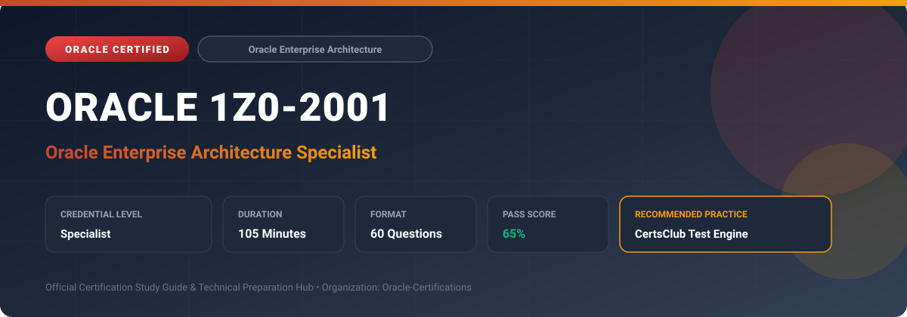

  

# Oracle 1Z0-2001: Oracle Enterprise Architecture Specialist

---

## 1. Exam Overview & Candidate Profile

The **Oracle 1Z0-2001: Oracle Enterprise Architecture Specialist** credential certifies professionals who demonstrate technical mastery, architectural competence, and hands-on operational capability in this certification domain.

Candidates validate comprehensive knowledge and expertise required to design, configure, manage, and optimize mission-critical Oracle environments across cloud, on-premises, and hybrid architectures.

### Target Audience & Prerequisites
- **Target Roles**: Implementation Specialists, Cloud Architects, Technical Leads, Enterprise Consultants, and Systems Engineers.
- **Recommended Experience**: 1–2 years of practical, hands-on experience designing, implementing, and maintaining corresponding Oracle solutions.
- **Credential Earned**: Specialist Certification.

---

## 2. Key Exam Specifications

| Specification | Details |
| :--- | :--- |
| **Exam Code** | **Oracle 1Z0-2001** |
| **Official Title** | Oracle Enterprise Architecture Specialist |
| **Certification Track** | Oracle Enterprise Architecture |
| **Exam Duration** | 105 Minutes |
| **Number of Questions** | 60 Questions |
| **Passing Score** | 65% |
| **Question Format** | Multiple Choice (Single/Multiple Answer), Scenario-Based Questions |
| **Delivery Provider** | Oracle University / Pearson VUE (Online Proctored or Test Center) |
| **Recommended Practice Engine** | [CertsClub Oracle Practice Tests](https://www.certsclub.com/oracle/1z0-2001-dumps.html) |

---

## 3. Official Blueprint & Exam Domain Breakdown

The examination assesses candidate competencies across core functional domains weighted as follows:

| Domain Area | Weighting |
| :--- | :--- |
| **Oracle Enterprise Architecture Framework (OEAF) Principles** | `25%` |
| **Business Architecture & Strategic Alignment** | `20%` |
| **Information & Data Architecture Strategy** | `20%` |
| **Application & Technology Portfolio Modernization** | `20%` |
| **Cloud Transformation Roadmaps, Governance & Risk** | `15%` |

---

## 4. Deep Dive into Complex & Challenging Technical Topics

To secure a passing score on the 1Z0-2001 exam, candidates must master the following advanced concepts:

- Applying the Oracle Enterprise Architecture Framework (OEAF) to align business strategic drivers with technology capabilities.
- Formulating current-state baseline and future-state target architectures across business, data, application, and infrastructure layers.
- Designing enterprise information architectures with master data management (MDM), data governance, and analytics capabilities.
- Creating pragmatic cloud transition roadmaps: evaluating rehosting, re-platforming, refactoring, and SaaS modernization options.
- Establishing architecture review boards (ARB), reference architectures, and technology debt governance mechanisms.

---

## 5. Scenario-Based Demo & Practice Questions

### Question 1
In the Oracle Enterprise Architecture Framework (OEAF), what is the primary purpose of constructing a Strategic Capability Map?

A) To visually represent core business capabilities and prioritize strategic investments based on business differentiation.
B) To document physical rack wiring in data centers.
C) To generate database table create scripts automatically.
D) To monitor network packet latency across routers.

- **Correct Answer**: `A) To visually represent core business capabilities and prioritize strategic investments based on business differentiation.`  
- **Technical Explanation**: A Strategic Capability Map defines what a business does to execute its strategy, helping enterprise architects evaluate which capabilities require differentiation and modernization.

---

### Question 2
When evaluating an enterprise application portfolio for cloud migration, what analysis identifies application criticality, technical debt, and cloud readiness?

A) Portfolio Rationalization & Cloud Readiness Assessment
B) Simple Ping Latency Scan
C) Memory Dump Trace Analysis
D) End-User Browser Cache Inspection

- **Correct Answer**: `A) Portfolio Rationalization & Cloud Readiness Assessment`  
- **Technical Explanation**: Portfolio rationalization assesses application business value, architecture fit, and complexity to categorize workloads into retain, retire, rehost, replatform, or replace dispositions.

---

## 6. Recommended Preparation Strategy & Practice Testing Engine

Achieving certification in **Oracle 1Z0-2001** requires balanced theoretical study and scenario-based simulation practice:

1. **Review Oracle Documentation**: Master architecture guides, implementation workbooks, and administration manuals on the Oracle Help Center.
2. **Hands-on Lab Practice**: Execute real-world configuration, policy setup, and troubleshooting tasks in your cloud tenancy or test instance.
3. **Simulated Exam Drills**: Practice answering timed, scenario-based multiple-choice questions to familiarize yourself with the question formats, traps, and timing constraints.

### Practice With CertsClub
For realistic practice questions, updated dumps, and mock testing environments:
- **Resource**: [CertsClub Oracle Practice Test Engine](https://www.certsclub.com/oracle/1z0-2001-dumps.html)
- **Special Discount**: Use coupon code **`club20`** during checkout for an instant **20% discount** on all practice exam bundles and testing engines.

---

## 7. Official Documentation & References

- [Oracle University Certification Registry](https://education.oracle.com/)
- [Oracle Help Center Documentation Portal](https://docs.oracle.com/)
- [Oracle Cloud Infrastructure & Applications Guides](https://docs.oracle.com/en/cloud/)
- [CertsClub Oracle Certification Exam Practice](https://www.certsclub.com/oracle/1z0-2001-dumps.html)

---

## 8. SEO & Discovery Keywords

`oracle 1z0-2001, oracle 1z0-2001 exam, oracle 1z0-2001 dumps, 1Z0-2001 practice questions, 1Z0-2001 study guide, oracle enterprise architecture specialist, certsclub 1z0-2001`